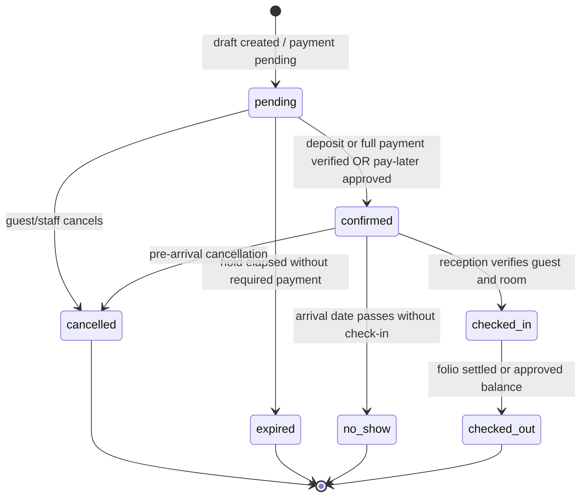
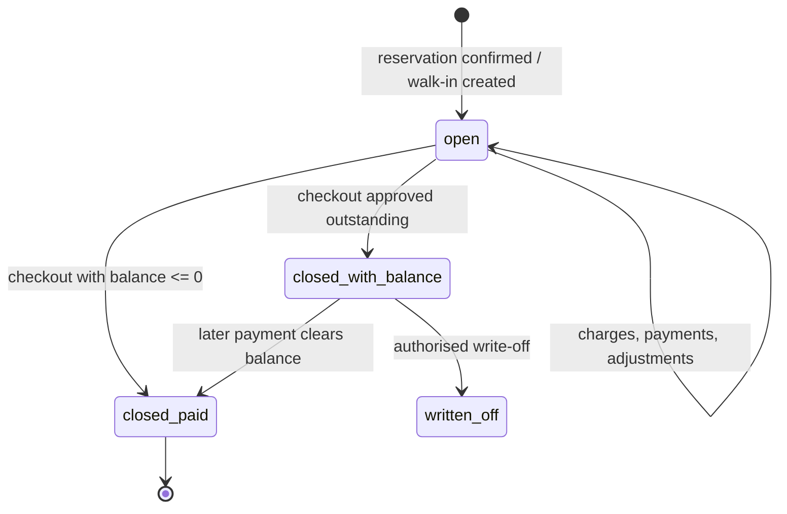
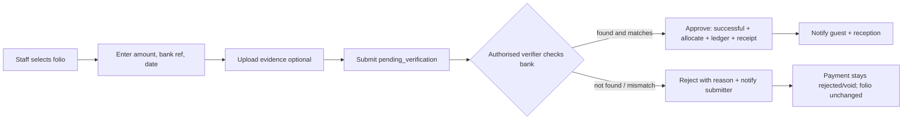
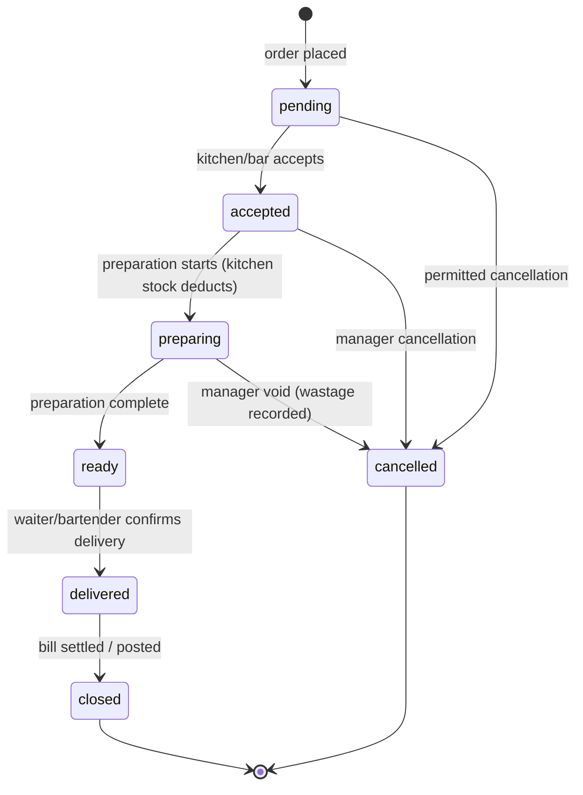
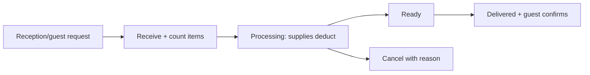
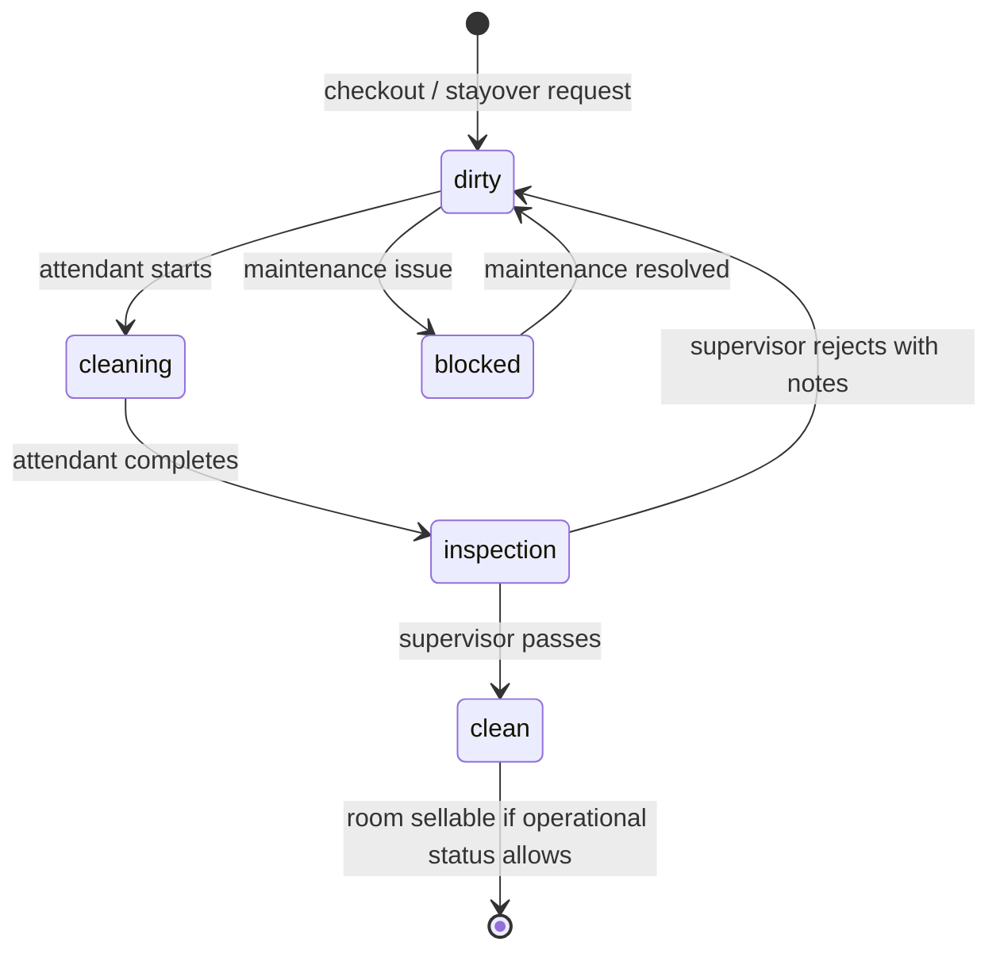
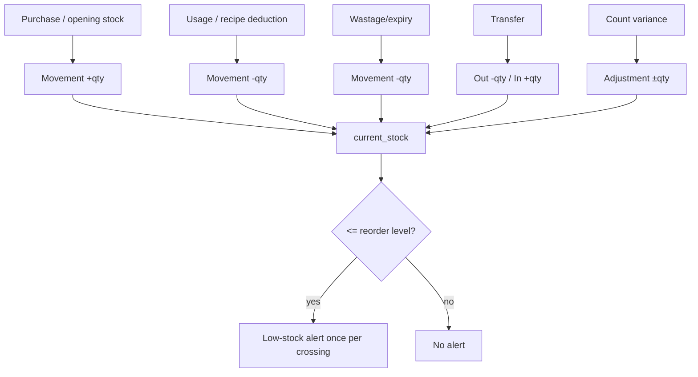
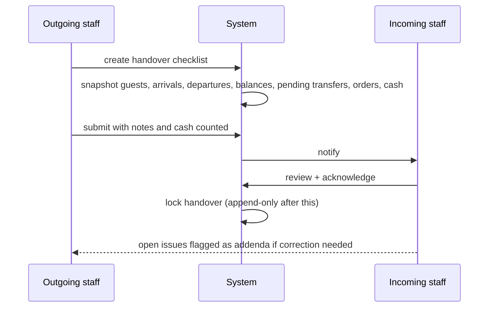
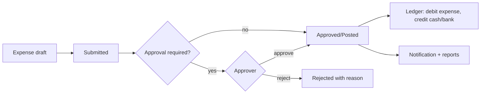

# Business Workflows and State Machines

**Status:** Draft for approval · **Version:** 0.1 · **Date:** 20 November 2026

All money calculations, availability decisions and state transitions are executed server-side in PostgreSQL transactions or server-only Next.js handlers. The client is never authoritative.

---

## 1. Reservation and availability

### 1.1 Reservation state machine



Payment status is independent: `unpaid`, `partially_paid`, `paid`, `overpaid`, `refunded`, `partially_refunded`. A confirmed reservation may still be partially paid.

### 1.2 Booking and deposit flow

```mermaid
sequenceDiagram
  actor G as Guest
  participant W as Web app
  participant S as Server action
  participant DB as PostgreSQL
  participant P as Paystack

  G->>W: dates, occupancy, room
  W->>S: availability query
  S->>DB: rooms minus active holds, blocked rooms
  DB-->>S: available rooms
  S-->>W: rates and policy
  G->>W: guest details + deposit/full choice
  W->>S: create reservation (server reprice)
  S->>DB: BEGIN; insert guest (find/create), reservation, folio, hold
  DB-->>S: conflict (23P01) or success
  alt room conflict
    S-->>W: 409 room no longer available
  else success
    S->>DB: insert pending payment + receipt intent
    S->>P: initialize transaction (amount in kobo)
    P-->>S: authorization_url, reference
    S-->>W: redirect
    G->>P: pay
    P-->>S: webhook charge.success (signed)
    S->>DB: verify + idempotent confirm payment, update folio
    S-->>G: confirmation email + receipt
  end
```

### 1.3 Pricing rules

- Stay is half-open: `[check_in, check_out)`; `nights = check_out - check_in` in hotel timezone.
- Room charges = sum of nightly rates from the applicable rate plan, with a price snapshot stored on the reservation.
- Discounts are explicit, permissioned and never produce a negative total.
- Tax is calculated per charge line, rounded to 2 decimal places; totals are stored as `numeric(14,2)`.
- `accommodation_amount = room_charges + accommodation_fees + accommodation_tax − accommodation_discount`.
- `required_deposit = round(accommodation_amount × deposit_percentage / 100, 2)`.
- `accommodation_balance = accommodation_amount − verified_accommodation_payments`.
- Rates and deposit configuration are snapshotted on the reservation so later settings changes cannot rewrite history.
- Default deposit is calculated after discount and tax; this assumption is listed for confirmation in `docs/13-DECISIONS.md`.

### 1.4 No-double-booking rule

`room_allocation_holds` contains one row per active reservation with `room_id` and a `daterange(check_in, check_out, '[)')` generated column.

```sql
ALTER TABLE room_allocation_holds
  ADD CONSTRAINT room_allocation_no_overlap
  EXCLUDE USING gist (room_id WITH =, stay WITH &&);
```

- Creation and any date/room modification run in a transaction and insert/update the hold.
- A PostgreSQL exclusion violation (`23P01`) is mapped to HTTP 409 with a friendly "room no longer available" message.
- Holds are deleted inside the same transaction when a reservation is cancelled, expired, checked out or marked no-show. Reservation status history retains the audit trail.
- A room in `maintenance` or `out_of_service` cannot be held for any overlapping date; blocked dates are checked before hold insertion and enforced by a database trigger.
- Two concurrent requests for the same last room: exactly one commits; the other receives a conflict. Verified by concurrency tests.

### 1.5 Expiry job

Runs every 5 minutes (Supabase `pg_cron` or scheduled Edge Function):

1. `SELECT ... FOR UPDATE SKIP LOCKED` pending reservations where `hold_expires_at <= now()` and required payment not met.
2. Set status `expired`, release hold, cancel pending payment intents, write status history and audit event.
3. Notify guest and front desk if the guest had started payment.
4. If a Paystack success arrives after expiry, do not resurrect the reservation: flag `payment_exception` for refund/manual resolution and alert manager/accountant.

---

## 2. Check-in, folio and check-out

### 2.1 Folio lifecycle



- One master folio per stay; departmental `bills` roll into it.
- Charges post only to an `open` or `closed_with_balance` folio with permission; a closed-paid folio rejects new charges.
- Folio summary is a SQL view: charges by department, taxes, discounts, adjustments, payments, refunds, balance.
- `balance = posted_charges − discounts − refunds − successful_payments`.
- Receipts link to payment, not to browser state. Reprints are marked duplicate.

### 2.2 Check-in

1. Search by reference, surname, phone or room.
2. Verify identity according to policy; record ID type/last digits if required (no full document in logs).
3. Validate reservation is `confirmed` (or approved pending with payment), dates include today, room operational and housekeeping clean; show warnings for exceptions.
4. Show outstanding balance and record optional payment.
5. Transaction: reservation → `checked_in`; actual check-in time and staff recorded; room occupancy derived; audit; notification to housekeeping for stayover planning.
6. Issue key/room instructions. No double occupancy.

### 2.3 Check-out

1. Open folio; review accommodation, food, bar, laundry, services, taxes, discounts, payments, refunds.
2. Apply permitted adjustments with reason.
3. Collect payment or record approved outstanding balance (`closed_with_balance`). Approval captures authoriser, reason and threshold.
4. Transaction: reservation → `checked_out`; room → `dirty`; release hold only if the dates are complete; close or mark folio; create departure housekeeping task idempotently; post final ledger entries; audit; email receipt.
5. Room is not sellable until housekeeping/inspection releases it.

### 2.4 Post-stay payments

- A folio with an approved balance remains `closed_with_balance` and accepts payments.
- Payment allocation is to the folio; receipt and ledger update immediately after verification.
- When balance reaches zero, folio becomes `closed_paid`; overpayment is blocked or held as a documented credit with approval.

---

## 3. Payments

### 3.1 Paystack online payment

```mermaid
sequenceDiagram
  participant W as Web app
  participant S as Server
  participant DB as DB
  participant PS as Paystack
  participant WH as Webhook endpoint

  W->>S: initiate payment(folio, amount, email)
  S->>DB: insert payment pending + unique reference
  S->>PS: initialize(amount kobo, reference, callback)
  PS-->>S: authorization_url
  S-->>W: redirect
  PS->>WH: POST charge.success + x-paystack-signature
  WH->>WH: verify HMAC SHA-512 raw body
  WH->>DB: insert payment_gateway_events (unique provider event id)
  alt duplicate event
    WH-->>PS: 200 (no-op)
  else new event
    WH->>DB: lock payment; verify amount/currency/status via API
    WH->>DB: mark successful + allocate to folio + ledger + receipt
    WH-->>PS: 200
  end
```

Rules:
- Never mark a payment successful from a frontend callback. The webhook or a server-side verify endpoint is authoritative.
- Unique constraints on `payments.provider_reference` and `payment_gateway_events.provider_event_id`.
- Amounts compare in minor units (kobo); currency must equal NGN.
- State transitions are monotonic: `pending → successful | failed`; `successful → partially_refunded | refunded`.
- Webhook route must read the raw body before JSON parsing for signature verification.
- Retries are safe; a duplicate returns 200 without side effects.
- A late payment for an expired/cancelled reservation goes to an exception queue; it is not applied to a new stay silently.

### 3.2 Cash / POS

1. Staff selects folio, amount, method, date, optional reference/terminal.
2. Server validates permission, amount > 0 and not exceeding balance unless overpayment approved.
3. Insert payment successful, allocate, post ledger, issue numbered receipt, audit.
4. Cash drawer totals feed the shift handover; discrepancies need a supervisor note.

### 3.3 Bank transfer verification



- Evidence is supporting documentation, not proof.
- Submitter ≠ verifier; override requires second approval and audit.
- Rejection reason is mandatory and visible to the submitter.
- A rejected transfer can be corrected by a new submission with a new reference; the old record is never deleted.

### 3.4 Refunds

- Request references original successful payment and reason.
- Approver checks policy and available unrefunded amount.
- Create refund record; call Paystack refund for online payments where supported; for cash/POS record manual refund evidence.
- Original payment remains; status becomes partially/fully refunded; ledger reversal posted; receipt/credit note issued; guest notified.

---

## 4. Restaurant, kitchen and bar

### 4.1 Order state machine



- Allowed transitions are checked in a database function, not only in UI.
- Every transition writes `order_status_history` with actor and timestamp.
- Kitchen and bar can have separate preparation views but share the same order record and numbering scheme (e.g. `FB-20261120-0042`).
- Waiter cannot mark delivered before `ready`.
- Room service destination must be an active stay; table destination must be an active table.
- Orders for walk-ins create/reuse a walk-in folio.

### 4.2 Stock deduction

| Department | Deduct when | Source |
|---|---|---|
| Kitchen | `accepted → preparing` | Recipe ingredients × item quantity (in base units) |
| Bar | `ready → delivered` | Product's linked inventory item × pour/unit quantity |
| Laundry | `received → processing` | Configured usage rule per service category/item |

Exactly-once rules:

1. Transition and deduction run in one transaction.
2. Each deduction writes `inventory_movements` with a unique idempotency key: `source_type:source_id:source_line_id:event`.
3. The order records `stock_deducted_at`; a repeat transition is a no-op.
4. Insufficient stock blocks the transition unless a permissioned override with reason is recorded.
5. Cancellation after deduction records a wastage/reversal movement; movements are never deleted.

---

## 5. Laundry



- Items are priced from laundry services; special instructions attach to the order.
- Received and delivered quantities are recorded; discrepancy requires a note.
- Charges post to the folio on order creation; cancellation before delivery voids the charge with audit (after delivery, refund/credit workflow).
- Attendant sees only laundry records and relevant stock.

---

## 6. Housekeeping



Rules:
- Checkout transition creates exactly one departure task per room/checkout (idempotent).
- A room cannot be set sellable until housekeeping status is `clean` (or inspection passes where required).
- Supervisor can be the manager; attendants cannot self-inspect.
- Photos are optional and stored privately; maintenance reports create a linked maintenance record.
- Cleaning history is retained for management review.

---

## 7. Inventory



- Movement is the only way to change stock. UI has no direct stock edit.
- Movement fields: item, quantity, type, previous stock, new stock, unit, unit cost, department, staff, source reference, reason, idempotency key, timestamp.
- Moving weighted average cost is recalculated on receipts and adjustments with cost; valuation = on-hand × current weighted average.
- Negative stock is blocked by default; an override permission writes a flag and reason.
- Low-stock alerts re-arm only after stock rises above the reorder level.

---

## 8. Attendance, shifts and handover

### 8.1 Shift and attendance

1. Manager creates shift templates (morning/afternoon/night; configurable times, grace, department).
2. Manager assigns staff per date. Overnight shifts use the assignment date and an end time on the next day.
3. Staff clocks in: server validates assignment, opens attendance record, computes late minutes in hotel timezone.
4. Staff clocks out: computes worked minutes and early departure; blocks duplicate close.
5. Manager adjustments require a reason and are appended to the audit log; original values retained.
6. Absence/no-show is explicitly marked; it is not inferred from a missing clock-out.

### 8.2 Shift handover



- Checklist includes current guests, expected arrivals/departures, outstanding balances, pending transfers, unresolved guest issues, maintenance issues, pending orders, cash collected, operational notes.
- Acknowledgement records incoming user/time; later corrections are addenda, not edits.
- Cash variance requires an explanation and manager visibility.

---

## 9. Expenses and financial ledger



Ledger rules:
- Chart of accounts: cash, bank, Paystack clearing, guest receivables, guest advances, departmental revenue, tax payable, refunds, operating expenses, other income.
- On charge posting: debit guest receivable; credit revenue by department and tax payable.
- On payment: debit cash/bank/clearing; credit guest receivable; advance payments before charges credit guest advances.
- On refund: debit guest receivable/refunds; credit cash/bank/clearing (or reverse original).
- On approved expense: debit expense category; credit cash/bank (or accounts payable if unpaid).
- Every journal header has a source type/id and idempotency key; lines must balance (trigger enforces).
- Cash collected is not revenue; revenue is recognized when the charge is posted. The UI labels these separately.
- No posted journal line can be updated or deleted by application roles.
- Daily close compares method totals (cash/POS/transfer/Paystack) with ledger clearing accounts and lists exceptions.
