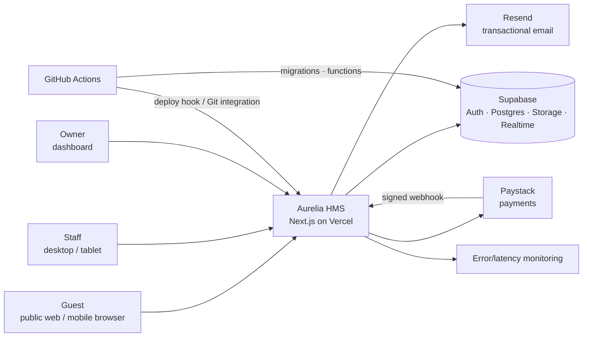
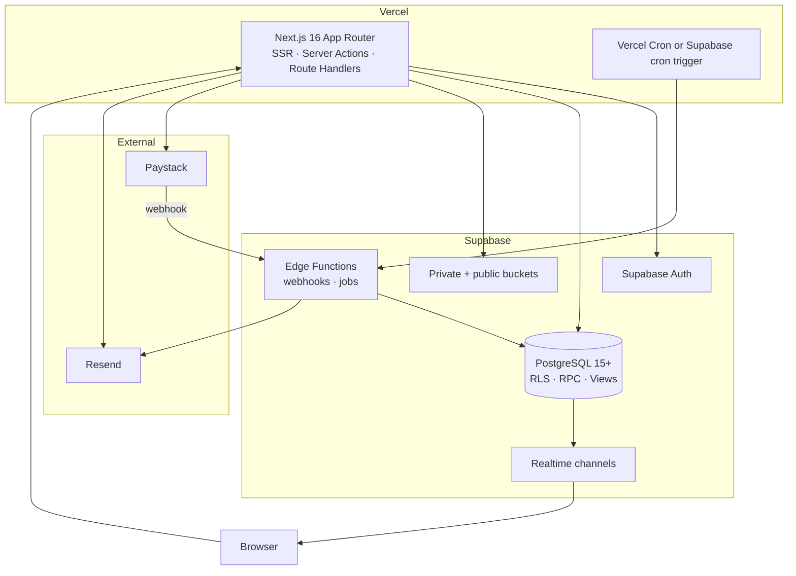
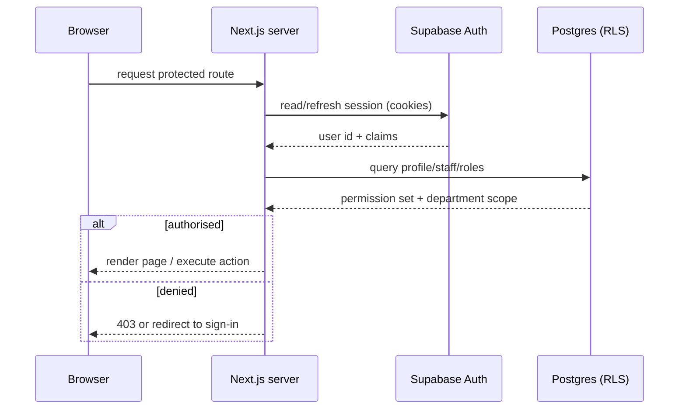

# System Architecture

**Status:** Draft for approval · **Version:** 0.1 · **Date:** 20 November 2026

## 1. Architectural drivers

- One property, one currency (NGN), one timezone (Africa/Lagos), but no hardcoded rates, taxes, deposits or policies.
- Financial correctness and auditability are more important than minimal code.
- Concurrency correctness for reservations and stock cannot depend on UI checks.
- Staff have shared devices and browser sessions; least privilege and re-authentication matter.
- The owner needs aggregate truth; departments need fast, focused queues.
- Deployments must be repeatable and reversible from GitHub.

## 2. System context



## 3. Deployment topology



**Key boundary:** the browser talks only to the Next.js app and Supabase Auth/Realtime/Storage using the anon key. Database mutations go through server actions, route handlers or RPCs. The service-role key exists only in server runtime and CI secrets.

## 4. Frontend architecture

- **Next.js 16 App Router** with React Server Components by default.
- Route groups:
  - `(public)` — marketing, rooms, booking, policies.
  - `(auth)` — sign-in, reset, verification.
  - `(guest)` — authenticated guest portal.
  - `(dashboard)` — staff and owner operations, role-guarded.
- Server Components fetch via the Supabase SSR client and render read-only data.
- Client Components own interaction: forms, dialogs, optimistic queues, charts, tables.
- Mutations use **Server Actions** for form-driven flows and **Route Handlers** for webhooks, downloads and APIs consumed by realtime clients.
- Zod schemas are shared between client forms and server handlers, but the server always revalidates.
- TanStack Table handles sortable/filterable staff data sets; Recharts renders dashboards; shadcn/ui + Tailwind provide the component layer.
- Cache Components is enabled. Public content is cached and revalidated on publish; authenticated dashboards stream runtime data behind Suspense boundaries; no guest-specific data is cached across users.
- Route-level guards check session + permission on the server before rendering. The sidebar hides inaccessible links, but direct URL access is still denied.
- `/api/health` exposes build version and database reachability without sensitive detail.

### 4.1 Repository layout

```text
app/
  (public)/            marketing, rooms, book, dining, contact
  (auth)/              login, reset
  (guest)/account/     guest dashboard
  (dashboard)/         owner, manager, reception, ... role routes
  api/                 webhooks, health, exports
components/
  ui/                  shadcn primitives
  site/                public shell and marketing blocks
  dashboard/           shell, KPI cards, charts, boards
  shared/              status badges, data table, empty states
features/
  authentication/ guests/ rooms/ reservations/ payments/ billing/
  restaurant/ bar/ laundry/ housekeeping/ inventory/ attendance/
  shifts/ accounting/ reports/ notifications/
lib/
  supabase/            browser, server, admin clients
  validation/          shared Zod schemas
  permissions/         server-side capability checks
  formatting/          money, dates, references
  jobs/                scheduled job clients
supabase/
  migrations/          versioned SQL
  functions/           Edge Functions (webhook, expiry, email, reports)
  seed.sql / seed files
  tests/               pgTAP RLS and transaction tests
tests/                 unit, integration, e2e
docs/
.github/workflows/
```

Each feature owns its components, actions, queries, schemas and types. Cross-feature reuse goes through explicit exports in `features/<name>/index.ts`, never deep relative imports.

## 5. Backend architecture

### 5.1 Supabase usage

| Capability | Use |
|---|---|
| Auth | Email/password, reset, optional MFA, JWT session; staff invitations. |
| Postgres | System of record; constraints, exclusion constraints, RLS, views, RPCs, triggers, `pg_cron` where available. |
| Storage | Public room/gallery images; private guest ID, payment evidence, maintenance photos, generated exports. |
| Realtime | Order queues, housekeeping board, notification badge; server remains source of truth. |
| Edge Functions | Paystack webhook, reservation expiry, email dispatch, report generation for long exports. |
| Cron | Expiry every 5 minutes, daily report snapshots, low-stock sweep, email retries. |

### 5.2 Business logic placement

- **Atomic invariants in PostgreSQL:** booking holds, folio totals, payment allocation, ledger balance, stock movements, order transitions, attendance uniqueness.
- **Orchestration in Next.js server layer:** permission checks, validation, calling RPCs, composing emails, mapping errors to UX.
- **Long-running work in Edge Functions/jobs:** webhook handling beyond fast acknowledgement, report generation, retries, expiry.
- No business rule lives only in a React component.

### 5.3 Example: creating a reservation

1. Server action authenticates and rate-limits.
2. Zod validates request; availability view checks candidate rooms.
3. Calls `rpc.create_reservation(...)` with a server-generated idempotency key.
4. RPC (security definer, pinned `search_path`) validates guest, dates, room state, reprices, inserts reservation + assignment + folio + hold + status history inside one transaction.
5. Postgres exclusion constraint rejects overlap. Unique idempotency key returns the prior result on retry.
6. Server initialises Paystack (if online) and returns reference/redirect.
7. Audit and notification events are written via triggers/outbox.

## 6. Authentication and authorisation flow



- Middleware/proxy refreshes session cookies; it does **not** perform final authorisation.
- Server layout/action guards call `requirePermission()` from `lib/permissions`.
- RLS policies independently enforce row access; tests verify both layers.
- Public booking is anonymous but still server-validated; guest lookup requires a second factor and rate limiting.
- Guest auth claims map to a `guests.auth_user_id`; staff auth claims map to `staff_profiles.profile_id`.

## 7. Payments architecture

- **Initiation:** server creates a pending payment row first, then initialises Paystack. The reference is ours and unique.
- **Verification:** webhook endpoint is the primary path; a server-side verify endpoint handles callbacks/recovery. Both share an idempotent `confirm_payment` function.
- **Idempotency:** unique `payment_gateway_events.provider_event_id`, unique `payments.provider_reference`, state machine checks, and a per-source ledger idempotency key.
- **Signature:** HMAC SHA-512 over the raw request body using the secret key; invalid requests are discarded and logged.
- **Amount/currency:** compare minor units and NGN; mismatches create an exception and do not credit.
- **Reconciliation:** unmatched gateway events and payment exceptions are visible to the accountant.
- **Secrets:** `PAYSTACK_SECRET_KEY` server-only; `NEXT_PUBLIC_PAYSTACK_PUBLIC_KEY` used only for inline UI if needed; webhook secret equals secret key per Paystack.

## 8. Realtime and notifications

- Realtime subscriptions are convenience channels scoped by RLS; on reconnect the client refetches.
- Notifications use a transactional outbox pattern: domain event inserts `notifications` row and an email job; worker marks sent/failed with retry backoff.
- Email templates live in versioned code, not user-editable HTML, to prevent injection.
- Critical events (payment, reservation) are also visible in the audit log and dashboard, so a lost email is not a lost operation.

## 9. Reporting and exports

- Reports are SQL views/functions over the ledger and operational tables; one metric has one definition.
- Short reports render server-side to PDF/XLSX/CSV and stream to the client with authorisation checks.
- Long reports create a private export, notify the requester and provide a signed download URL.
- Exports include filters, generation time, generated-by and a footer page count.
- No raw table export to unauthorised roles; column-level redaction for PII.

## 10. Security architecture

| Layer | Control |
|---|---|
| Edge | HTTPS/HSTS, security headers, CSP, rate limiting on public endpoints. |
| Session | httpOnly secure cookies, refresh rotation, short staff idle timeout. |
| Application | Server-side permission checks, Zod validation, origin checks, no destructive GET. |
| Database | RLS deny-by-default, least-privilege grants, security-definer functions with pinned search_path, exclusion constraints, append-only audit/ledger. |
| Storage | Private buckets, signed URLs, MIME/size limits, virus-scanning hook where available. |
| Secrets | Environment variables, GitHub environment protection, no secrets in code/build logs. |
| Payment | HMAC verification, server-side amount checks, replay protection, exception queue. |
| Operations | Structured logs without PII, error monitoring, access reviews, backup restore drills. |

Threats explicitly considered: IDOR/BOLA, privilege escalation, double booking races, webhook forgery/replay, payment amount tampering, stock deduction replay, transfer fraud, receipt tampering, CSV formula injection, stored XSS in guest notes/content, file upload abuse.

## 11. Reliability and failure handling

- Every mutation returns a typed result; expected business conflicts (room taken, insufficient stock, invalid transition) are 409/422, not 500.
- External calls have timeouts and bounded retries with idempotency; no retry for non-idempotent operations.
- Webhook handler acknowledges after durable insertion; downstream processing can retry from the event row.
- Jobs acquire row locks with `SKIP LOCKED` and are safe to run concurrently.
- Payment and reservation state changes are monotonic; invalid transitions are rejected, not silently fixed.
- Manual fallback procedures are documented for Paystack/email/Supabase outage.

## 12. Observability

- Request ID generated at the proxy and propagated to logs, audit events and error reports.
- Log fields: timestamp, level, request_id, route, method, status, duration_ms, user_id (hashed for public), hotel_id, error code.
- Alerts: webhook signature failures, payment verification lag, expiry job failure, negative stock attempt, ledger imbalance, report job failure, 5xx rate, auth brute-force.
- Daily operational digest to owner/manager; weekly access/security summary.

## 13. Technology decisions

See `docs/13-DECISIONS.md` for ADR detail, including why no ORM, why numeric money, why exclusion constraints, why a ledger, and why server-side report generation.
