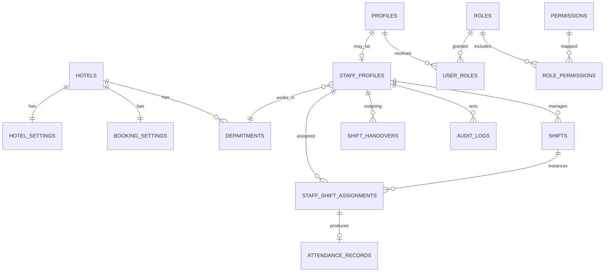
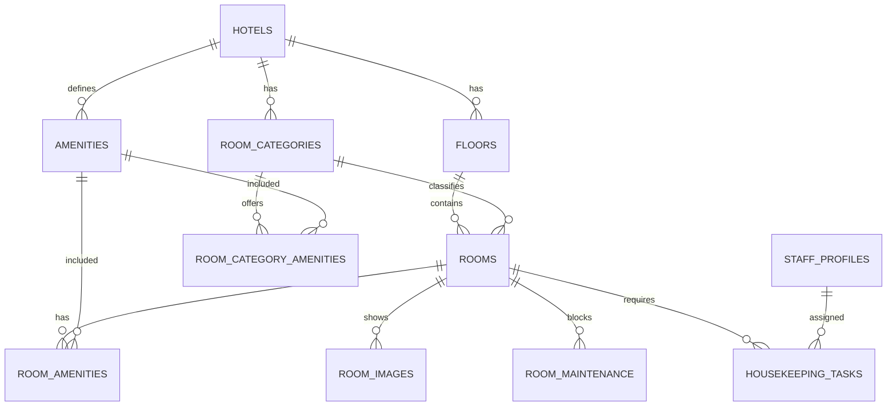
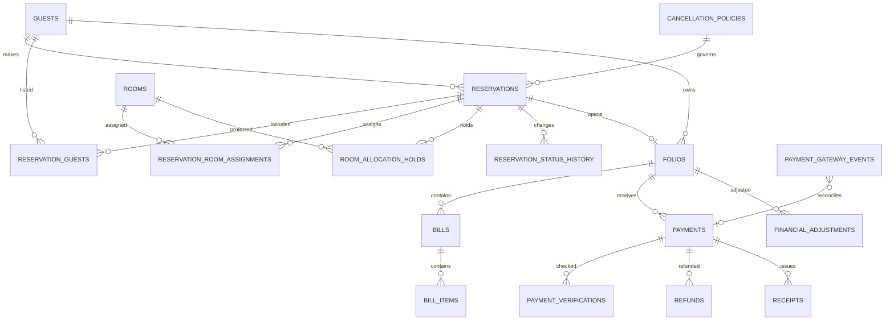
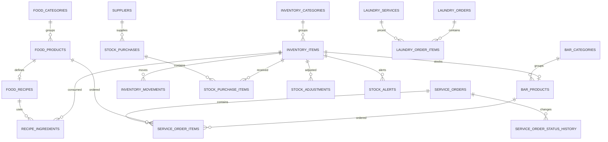
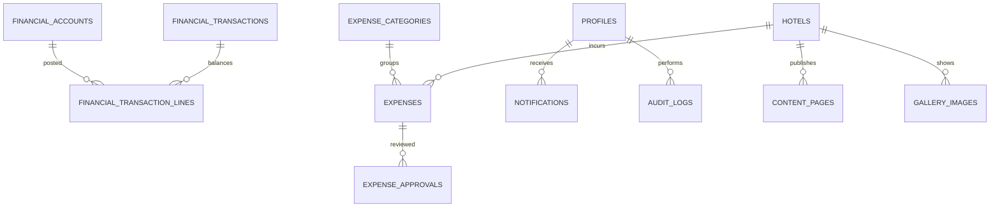

# Database Design

**Status:** Draft for approval · **Version:** 0.2 · **Date:** 22 November 2026
**Engine:** PostgreSQL 15+ (Supabase) · **Extensions:** `pgcrypto`, `btree_gist`, `pg_trgm`, `citext`, `pg_cron` where available.

## 1. Conventions

| Concern | Convention |
|---|---|
| Primary keys | `uuid DEFAULT gen_random_uuid()`; never expose sequential ids publicly. |
| Tenant | `hotel_id uuid NOT NULL REFERENCES hotels(id)` on every operational root; single seeded hotel for MVP. |
| Money | `numeric(14,2)`; currency code stored beside amounts. Never floating point for money. |
| Quantities | `numeric(14,3)` in the item's base unit. |
| Tax/discount rates | `numeric(5,2)` percentage, 0–100 check. |
| Time | `timestamptz` in UTC; display in hotel timezone. Dates for stays (`date`) are calendar dates in the hotel timezone. |
| Human references | Generated by `number_sequences` inside a transaction, e.g. `AUR-2026-000123`, `RCP-2026-000045`; never reused. |
| Status fields | PostgreSQL enums or `text + CHECK`; enums preferred for fixed workflows. Transitions enforced by functions. |
| Audit columns | `created_at`, `created_by`, `updated_at`, `updated_by` where mutation is allowed. |
| Soft delete | `is_active` / `deleted_at` for catalogs and guests with history; financial/audit rows are never deleted. |
| Naming | snake_case, plural tables, singular columns, explicit FKs (`guest_id`). |

## 2. Domain ERDs (key attributes)

### 2.1 Identity, hotel and staff



### 2.2 Rooms and housekeeping



### 2.3 Guests, reservations and billing



### 2.4 Food, beverage, laundry and inventory



### 2.5 Finance, audit and engagement



## 3. Table catalogue

### 3.1 Identity and access

| Table | Purpose and key constraints |
|---|---|
| `hotels` | Single property root. `code` unique, name, timezone, currency, address, contacts. |
| `hotel_settings` | One row per hotel. Tax rate, check-in/out times, receipt prefix, policies, logo/storage paths, contact/social links. |
| `booking_settings` | One row per hotel. `deposit_percentage numeric(5,2) CHECK 0–100`, `deposit_required`, `full_payment_allowed`, `hold_minutes`, default cancellation policy. |
| `profiles` | Auth-linked identity: `id = auth.users.id`, full name, email `citext`, phone, avatar, `is_active`, `last_seen_at`. |
| `roles` | `key` unique (`owner`, `manager`, ...), display name, `is_system`. |
| `permissions` | `key` unique, description, scope (`self`, `department`, `assigned`, `all`). |
| `role_permissions` | PK `(role_id, permission_id)`; seeded and audited. |
| `user_roles` | PK `(user_id, role_id)`; `granted_by`, `granted_at`; cannot self-grant owner. |
| `departments` | `key` unique, name; referenced by staff, shifts, expenses, inventory. |
| `staff_profiles` | `profile_id` unique, `staff_number` unique, department, job title, employment status, hire/termination dates, emergency contact. |
| `staff_activity_logs` | Operational event trail: staff, activity type, entity, safe metadata, timestamp. |
| `audit_logs` | Append-only: actor, role, action, entity, before/after redacted JSON, IP, UA, request id. No update/delete policy. |
| `system_settings` | Non-hotel feature flags/config keyed by `key`; `is_public` controls exposure. |
| `email_outbox` | Outbox for transactional email: template, payload, attempts, next attempt, status, provider id. |
| `report_exports` | Generated report metadata: type, filters, requester, storage path, status, expiry. |

### 3.2 Hotel structure and housekeeping

| Table | Purpose and key constraints |
|---|---|
| `floors` | Hotel, name, level, `is_active`, sort. Unique `(hotel_id, name)`. |
| `room_categories` | Name, slug, description, base rate, max occupancy, bed config, size, sort. Unique slug per hotel. |
| `amenities` | Name, icon key, category, active. Unique per hotel. |
| `room_category_amenities` | Join category ↔ amenity. |
| `rooms` | Hotel, floor, category, `number` unique per hotel, name, rate override, max occupancy, `operational_status`, `housekeeping_status`, `is_active`, sort. |
| `room_amenities` | Room-specific amenities in addition to category defaults. |
| `room_images` | Room or category image, storage path, alt text, primary flag, sort. |
| `room_maintenance` | Room, reason, description, start/end, status, cost, supplier, reported by, resolved by/time. Blocks overlapping stays. |
| `housekeeping_tasks` | Room, task type (`departure`, `stayover`, `deep_clean`, `inspection`, `maintenance_followup`), status, priority, assignment, linked reservation, due date, timestamps, inspector, notes, private evidence path. Partial unique index on open departure task per room/reservation. |

### 3.3 Guests and reservations

| Table | Purpose and key constraints |
|---|---|
| `guests` | Hotel, name, `email`/`phone` + normalized columns, address, country, ID type + private document path (never full number in logs), emergency contact, notes, marketing consent, `auth_user_id` unique nullable, `merged_into_id`, `is_active`. |
| `reservations` | `reference` unique, guest, stay dates, adults/children, nights, room subtotal, discount, tax, fees, accommodation total, deposit percentage snapshot, required deposit, currency, status, payment status, source, special requests, internal notes, hold expiry, cancellation/no-show metadata, created by. `CHECK check_out > check_in`. |
| `reservation_guests` | Reservation ↔ guest, `is_primary`, relationship. PK `(reservation_id, guest_id)`, one primary per reservation. |
| `reservation_room_assignments` | Reservation ↔ room, nightly rate, check-in/out, occupancy, `is_primary`. Unique `(reservation_id, room_id)`; one primary per reservation. |
| `room_allocation_holds` | Active inventory hold: reservation, room, generated `stay daterange(check_in, check_out, '[)')`. **Exclusion constraint** with `btree_gist` prevents overlap per room. |
| `reservation_status_history` | From/to status, reason, actor, timestamp. Append-only. |
| `cancellation_policies` | Name, free cancellation window hours, charge type/value, terms, default flag. |
| `rate_plans` | Category/room scope, name, rate, validity dates, min nights, active. Used by future dynamic rates; MVP uses category base rate + room override. |

### 3.4 Billing and payments

| Table | Purpose and key constraints |
|---|---|
| `folios` | `folio_number` unique, hotel, reservation (nullable for walk-in), guest (nullable), type (`guest`, `walk_in`, `event`, `house`), status, currency, opened/closed timestamps. |
| `bills` | Departmental bill within a folio: department, source type/id, subtotal, tax, discount, total, status, posted by/time, void metadata. |
| `bill_items` | Description/category snapshot, qty, unit price, tax rate/amount, discount, total, source linkage, posted by/time, `is_void` + reason. Posted items immutable except void flag via controlled function. |
| `payments` | `reference` unique, folio, reservation nullable, provider (`paystack`, `cash`, `pos`, `bank_transfer`), provider reference unique when present, amount > 0, currency, status, paid/recorded/verified metadata, receipt number, idempotency key unique. |
| `payment_verifications` | Payment, action (`approve`/`reject`), checker, time, notes, bank reference, evidence path. |
| `payment_gateway_events` | Provider, `provider_event_id` unique, type, full payload, signature validity, processing status, error, linked payment. Raw payload retained for 180 days. |
| `refunds` | Original payment, folio, amount, reason, status, requester, approver, provider refund reference, processed time. Sum of refunds ≤ payment amount (function-enforced). |
| `receipts` | Payment, unique receipt number, issued-to snapshot, issued by/time, PDF path, duplicate marker. |
| `payment_exceptions` | Late/overpaid/mismatched/duplicate gateway events requiring accountant resolution; status, notes, resolver. |
| `financial_accounts` | Chart of accounts: code unique, name, type, normal balance, active. |
| `financial_transactions` | Journal header: type, source type/id, unique idempotency key, occurred/posted times, posted by, status, reversal link. |
| `financial_transaction_lines` | Account, debit/credit (exactly one > 0), department, guest, folio, memo. Balanced transaction enforced by trigger. |
| `financial_adjustments` | Folio adjustment: type, amount, reason, requester, approver, status, ledger link. |
| `number_sequences` | Scope/prefix/year/current value; `SELECT ... FOR UPDATE` to allocate human references. |

### 3.5 Food, bar and laundry

| Table | Purpose and key constraints |
|---|---|
| `food_categories` | Name, slug, sort, active. |
| `food_products` | Category, name, description, price, photo, prep minutes, availability, tax rate, SKU, sort. Historical order items snapshot price. |
| `food_recipes` | One per food product; yield quantity, notes. |
| `recipe_ingredients` | Recipe, inventory item, quantity in base unit. Unique `(recipe_id, inventory_item_id)`. |
| `bar_categories` | Name, slug, sort, active. |
| `bar_products` | Category, inventory item (optional), name, price, pour/unit quantity, photo, availability, tax, age-restricted. |
| `dining_tables` | Label unique, area, capacity, status, active. |
| `service_orders` | `reference` unique, department (`restaurant`, `bar`), order type, folio, guest/room/table, status, assignment, totals, placed/accepted/ready/delivered/closed timestamps, `stock_deducted_at`. |
| `service_order_items` | Order, product type, exactly one food/bar FK, description/price snapshot, qty, tax, discount, total, notes, stock deduction marker. |
| `service_order_status_history` | From/to, actor, timestamp, reason. Append-only. |
| `laundry_services` | Category/name, price, unit, turnaround, active, sort. |
| `laundry_orders` | `reference` unique, guest/room/folio, status, instructions, totals, staff/timestamps, `stock_deducted_at`, cancel reason. |
| `laundry_order_items` | Service snapshot, qty received/expected/delivered, price, total, discrepancy note. |

### 3.6 Inventory

| Table | Purpose and key constraints |
|---|---|
| `suppliers` | Name, contacts, address, active. |
| `inventory_categories` | Name, department, sort, active. |
| `inventory_locations` | Store/bar/kitchen/laundry locations, type, active. |
| `inventory_items` | SKU unique, category, name, base unit, `current_stock numeric(14,3)`, reorder level, moving average `unit_cost`, expiry tracking, active. |
| `inventory_movements` | Append-only movement: signed qty, previous/new stock, unit, unit cost, location, department, staff, source type/id/line, reason, `idempotency_key` unique, occurred_at. |
| `stock_purchases` | Supplier, invoice, date, totals, status, evidence, recorder. |
| `stock_purchase_items` | Purchase, item, qty, unit cost, total. Receipt generates movements. |
| `stock_adjustments` | Item, signed qty, reason, requester, approver, status, movement link. |
| `stock_alerts` | Item, threshold snapshot, status, timestamps. Partial unique index: one `open` alert per item. |

### 3.7 Staff operations

| Table | Purpose and key constraints |
|---|---|
| `shifts` | Name, department, start/end time, grace minutes, active. Handles overnight where end < start. |
| `staff_shift_assignments` | Staff, shift, work date, status, assigned by. Unique `(staff_id, work_date, shift_id)`. |
| `attendance_records` | Assignment unique, work date, clock in/out, late/early/worked minutes, status, notes, adjustment actor/reason. One open record per staff. |
| `shift_handovers` | Hotel, department, shift date, outgoing/incoming staff, status, checklist JSON, notes, expected/counted cash, variance, acknowledgement. Locked after acknowledgement; addenda recorded separately. |

### 3.8 Finance and administration

| Table | Purpose and key constraints |
|---|---|
| `expense_categories` | Name, ledger account, active. |
| `expenses` | Category, department, supplier optional, amount, tax, date, description, status, private evidence, submitter, approver/time, rejection reason, ledger link. |
| `expense_approvals` | Append-only approval/rejection trail. |
| `services` | Other billable services (airport transfer, spa, late checkout), price, unit, department, taxable, active. |
| `content_pages` | Public page slug unique, title, structured body, SEO metadata, status, publisher/time. |
| `gallery_images` | Public gallery storage path, alt text, category, sort, published. |
| `testimonials` | Guest name/quote/rating/published/sort. |
| `faqs` | Question/answer/sort/published. |
| `contact_messages` | Public contact submissions, status, assigned to, timestamps. PII access restricted. |
| `notifications` | User, category, title/body/link, channel, read time, dedupe key. Unique `(user_id, dedupe_key)` where dedupe key is not null. |

## 4. Key constraints and invariants

```sql
-- No overlapping active room holds (the core anti-double-booking rule)
ALTER TABLE room_allocation_holds
  ADD CONSTRAINT room_allocation_no_overlap
  EXCLUDE USING gist (room_id WITH =, stay WITH &&);

-- One primary room and one primary guest per reservation
CREATE UNIQUE INDEX one_primary_room_per_reservation
  ON reservation_room_assignments (reservation_id) WHERE is_primary;
CREATE UNIQUE INDEX one_primary_guest_per_reservation
  ON reservation_guests (reservation_id) WHERE is_primary;

-- Money and quantity sanity
ALTER TABLE payments ADD CONSTRAINT payment_amount_positive CHECK (amount > 0);
ALTER TABLE refunds ADD CONSTRAINT refund_amount_positive CHECK (amount > 0);
ALTER TABLE bill_items ADD CONSTRAINT bill_item_qty_positive CHECK (quantity > 0);
-- Enforced by private.guard_inventory_stock(); negative stock requires an authorised override.
ALTER TABLE financial_transaction_lines
  ADD CONSTRAINT one_side_only CHECK (
    (debit IS NOT NULL AND credit IS NULL AND debit > 0)
    OR (credit IS NOT NULL AND debit IS NULL AND credit > 0)
  );

-- One open attendance record per staff
CREATE UNIQUE INDEX one_open_attendance_per_staff
  ON attendance_records (staff_id) WHERE clock_out_at IS NULL;

-- One open low-stock alert per item
CREATE UNIQUE INDEX one_open_stock_alert
  ON stock_alerts (item_id) WHERE status = 'open';

-- Idempotency
ALTER TABLE inventory_movements ADD CONSTRAINT inventory_movement_idem UNIQUE (idempotency_key);
ALTER TABLE financial_transactions ADD CONSTRAINT ledger_idem UNIQUE (idempotency_key);
ALTER TABLE payments ADD CONSTRAINT payment_idem UNIQUE (idempotency_key);
```

Additional triggers/functions enforce:
- `check_out >= check_in` and nights > 0.
- Room blocked by maintenance/OOS for overlapping dates cannot be held.
- A folio cannot accept new charges after `closed_paid` or `void`.
- A posted bill item/payment/ledger line cannot be updated or deleted; corrections append.
- Attendance clock-out cannot precede clock-in; one open record.
- Journal debits equal credits and one side per line.
- Inventory new stock equals previous stock + signed movement quantity, and cannot go negative unless an authorised override is set.
- Order status transitions follow the allowed matrix; stock deduction occurs at most once per source line/event.
- Checkout creates exactly one open departure housekeeping task.

## 5. Index strategy

| Area | Indexes |
|---|---|
| Rooms | `(hotel_id, floor_id)`, `(hotel_id, category_id)`, `(hotel_id, operational_status)` partial where active; unique `(hotel_id, number)`. |
| Holds | GiST `(room_id, stay)` from exclusion constraint; `(reservation_id)`. |
| Reservations | `(hotel_id, check_in)`, `(hotel_id, check_out)`, `(hotel_id, status)`, `(guest_id)`, unique `reference`; partial `(hold_expires_at) WHERE status='pending'`. |
| Guests | unique `(hotel_id, normalized_email)` where not null and active? Emails may repeat for families; use trigram indexes on name, btree on phone/email, unique `auth_user_id`. |
| Folios/bills | `(reservation_id)`, `(guest_id)`, `(status)`, `(folio_id)`; bill items `(bill_id)`. |
| Payments | `(folio_id)`, `(status)`, `(paid_at)`, unique `reference`, unique `provider_reference`; gateway `provider_event_id` unique, `(processing_status)`. |
| Orders | `(hotel_id, department, status, placed_at)`, `(assigned_to)`, `(room_id)`, `(folio_id)`; items `(order_id)`. |
| Inventory | movements `(item_id, occurred_at DESC)`, `(department_id, occurred_at)`, `(source_type, source_id)`; items `(category_id)`, `(current_stock <= reorder_level)` partial for low stock. |
| Attendance | `(staff_id, work_date)`, `(work_date, status)`, `(assignment_id)` unique. |
| Ledger | `(account_id, occurred_at)`, `(source_type, source_id)`, `(folio_id)`, `(department_id)`. |
| Audit | BRIN `(created_at)`, `(entity_type, entity_id)`, `(actor_user_id)`, `(action)`. |
| Notifications | `(user_id, read_at)`, unique dedupe. |
| Search | `pg_trgm` GIN on guest name, reservation reference, folio number, payment reference. |

Hot-path queries must be reviewed with `EXPLAIN (ANALYZE, BUFFERS)` using production-like volumes.

## 6. Database functions and triggers

### 6.1 Security helpers (`private` schema)

- `current_staff_id() uuid`
- `current_guest_id() uuid`
- `has_role(text) boolean`
- `has_permission(text) boolean`
- `has_department_scope(uuid) boolean`
- `is_owner_readonly() boolean`

All are `STABLE`/`IMMUTABLE` as appropriate and use `auth.uid()` only.

### 6.2 Business RPCs (callable only by authenticated roles unless noted)

| Function | Guarantees |
|---|---|
| `get_available_rooms(check_in, check_out, adults, children)` | Excludes active holds, maintenance, OOS; returns rate and policy. `SECURITY DEFINER` + validated args. |
| `create_reservation(payload jsonb)` | Validates guest/room/dates, reprices server-side, inserts reservation/assignment/folio/hold/history atomically, honours idempotency key, maps exclusion conflict. |
| `modify_reservation(reservation_id, payload)` | Revalidates availability, reprice deltas, audit, hold update. |
| `cancel_reservation(...)`, `mark_no_show(...)`, `expire_reservations()` | State machine, hold release, policy fee posting, idempotent. |
| `check_in(reservation_id, ...)` | Verifies status/room/housekeeping, records time, room state, audit. |
| `check_out(reservation_id, ...)` | Balance check/approval, closes folio or receivable, releases hold, creates housekeeping task, ledger, audit. |
| `post_bill_item(...)` | Permission check, folio state check, tax/total calculation, ledger posting, duplicate guard. |
| `record_manual_payment(...)` | Cash/POS; amount/status validation, allocation, ledger, receipt, audit. |
| `submit_bank_transfer(...)` | Pending verification; cannot self-verify. |
| `verify_bank_transfer(payment_id, decision, notes)` | Approve/reject; ledger only on approval; notification. |
| `confirm_paystack_payment(...)` | Idempotent successful payment, allocation, ledger, receipt. |
| `refund_payment(payment_id, amount, reason)` | Approval and cap checks, reversal ledger, provider refund. |
| `create_service_order(...)` | Idempotent restaurant/bar order creation; folio and department validation. |
| `transition_service_order(order_id, to_status)` | Allowed transition matrix, timestamps, history, idempotent stock trigger. |
| `deduct_order_stock(order_id)` | Exactly-once recipe/bar/laundry deductions with movement idempotency keys. |
| `create_laundry_order(...)`, `cancel_laundry_order(...)`, `deliver_laundry_order(...)` | Laundry state machine, folio billing and supply usage rules. |
| `private.post_stock_movement(...)` | Append-only stock change, previous/new stock, low-stock alert, valuation, override guard. |
| `record_inventory_movement(...)` | Public wrapper for authorised stock movement recording. |
| `receive_stock_purchase(...)` | Purchase + lines + movements atomically. |
| `request_stock_adjustment(...)`, `approve_stock_adjustment(...)` | Segregated adjustment workflow with reason and approval. |
| `record_stock_usage(...)`, `transfer_stock(...)`, `acknowledge_stock_alert(...)` | Manual usage, location transfer and alert acknowledgement. |
| `clock_in()`, `clock_out()` | Assignment validation, one open record, late/early minutes. |
| `mark_attendance_exception(...)`, `adjust_attendance(...)` | Manager-controlled attendance corrections with reason. |
| `create_shift_handover(...)`, `submit_shift_handover(...)`, `acknowledge_shift_handover(...)` | Snapshot, submission, acknowledgement and lock after acknowledgement. |
| `approve_expense(...)` | Segregation of duties, ledger posting, audit. |
| `post_journal(...)` | Balanced lines, idempotent, immutable. |
| `allocate_reference(scope)` | Atomic human-readable reference allocation. |

Functions are versioned in migrations, with `SET search_path = public, private, pg_temp` and explicit grants.

### 6.3 Triggers

- `set_updated_at()` for mutable tables.
- `audit_row_change()` for settings, roles, rates, reservations, folios, payments, refunds, expenses, inventory adjustments, attendance adjustments, content.
- `reservation_status_history_trigger()` after reservation status change.
- `enforce_allowed_order_transition()` before update.
- `prevent_posted_financial_mutation()` before update/delete on payments, receipts, bill items, ledger lines, refunds.
- `journal_balance_check()` after insert/update/delete of journal lines (deferred constraint).
- `sync_stock_from_movement()` after insert on inventory_movements (updates item current stock and valuation, raises alerts).
- `folio_close_guard()` prevents charges to closed folios.
- `checkout_housekeeping_trigger()` idempotently creates departure task.
- `notification_dispatch()` inserts email outbox rows for configured categories.

## 7. Views and report definitions

| View / function | Definition |
|---|---|
| `v_room_status` | Room + category + floor + occupancy from active checked-in stay + operational + housekeeping + sellable flag. |
| `v_folio_summary` | Folio, charges by department, taxes, discounts, adjustments, payments, refunds, balance. Single source for UI and receipts. |
| `v_reservation_financials` | Accommodation total, verified payments, balance, payment status; never trust stored totals. |
| `v_daily_occupancy` | Sold room-nights ÷ sellable room-nights, excludes OOS, uses hotel date. |
| `v_daily_revenue` | Revenue recognised by department and tax from ledger. |
| `v_daily_collections` | Successful payments by method and verifier. |
| `v_outstanding_balances` | Open or closed-with-balance folios with ageing buckets. |
| `v_low_stock` | Items at or below reorder level with suggested reorder quantity. |
| `v_inventory_valuation` | On-hand × weighted average cost by category/department. |
| `v_department_revenue` | Ledger revenue by department/date range. |
| `v_payment_method_summary` | Totals and counts by provider/status/date. |
| `v_staff_attendance_daily` | Scheduled vs clocked, late/early/absent minutes. |
| `v_staff_performance` | Completed orders/tasks, attendance rate, punctuality by staff/date. |
| `v_pending_verifications` | Payments pending verification with submitter/age. |
| `v_notification_feed` | Role-scoped notifications with read state. |

Materialised views: `mv_daily_revenue`, `mv_daily_occupancy` refreshed every 15 minutes and after daily close; owner trends may read them. Operational counters use live views. A `report_metadata` table documents each metric's formula and last refresh.

## 8. RLS and grants

- RLS enabled on every table in `public`.
- `anon` has `select` on public tables/views, but only catalog/content rows are visible through policies.
- `authenticated` has `select, insert, update, delete` on public tables/views, but access is restricted by RLS policies; no `FORCE ROW LEVEL SECURITY` so migration-owned seed operations work.
- Permission-based policy checks require an active staff profile; guest-role permission keys cannot grant staff-level row access.
- Service role bypasses RLS but is used only in server code and jobs.
- Policies are documented in `docs/08-RLS-MATRIX.md`; `supabase/tests/rls.sql` passes 32 pgTAP assertions via `npm run test:db`.
- Storage object policies are path-prefixed by `hotel_id`, entity type and entity UUID; `supabase/tests/storage.sql` passes 15 pgTAP assertions.
- Idempotency, retry guards and contested-room exclusion are covered by `supabase/tests/concurrency.sql` with 14 pgTAP assertions.

## 9. Deletion and retention rules

| Data | Rule |
|---|---|
| Financial (payments, ledger, refunds, receipts, bill items) | Never hard-delete. Void/reverse with audit. |
| Reservations/folios | Retain; cancel/write off rather than delete. |
| Audit logs | Append-only; retain ≥ 7 years or per counsel. |
| Guests | Archive/anonymise after retention, preserving accounting references; merge duplicates with audit. |
| Catalogs | Deactivate (`is_active`); delete only unreferenced drafts. |
| Holds | Delete operationally on release; history retained in reservation status history. |
| Notifications/email outbox | Purge after 12 months except security/financial notices. |
| Gateway raw payloads | Purge after 180 days, keeping normalised event and result. |
| Uploaded ID/evidence | Private; delete per retention schedule, replace with redacted metadata if referenced by audit. |

FK rules: financial parents use `RESTRICT`; dependent draft children may cascade; `profiles` deletion is restricted while staff/audit references exist; `guests` deletion restricted while reservations exist.

## 10. Migration plan

| Migration | Contents |
|---|---|
| `0001_extensions` | `pgcrypto`, `btree_gist`, `pg_trgm`, `citext`, private schema. |
| `0002_enums` | Reservation, payment, folio, order, laundry, attendance, expense, maintenance, stock statuses. |
| `0003_identity` | hotels, settings, profiles, roles, permissions, departments, staff. |
| `0004_rooms` | floors, categories, amenities, rooms, images, maintenance, housekeeping. |
| `0005_reservations` | guests, reservations, assignments, holds, history, policies. |
| `0006_billing` | folios, bills, payments, verification, gateway events, refunds, receipts, adjustments. |
| `0007_fnb` | food/bar menus, recipes, tables, service orders. |
| `0008_laundry_inventory` | laundry, suppliers, inventory, purchases, alerts. |
| `0009_staff_ops` | shifts, assignments, attendance, handovers, activity logs. |
| `0010_finance` | accounts, journal, expenses, approvals, services. |
| `0011_content` | content pages, gallery, testimonials, FAQs, contact messages. |
| `0012_views` | operational views and materialised views. |
| `0013_functions_triggers` | RPCs, audit, guards, stock, ledger. |
| `0014_rls` | grants and policies. |
| `0015_seed` | roles, permissions, hotel, settings, chart of accounts, reference catalogs. |
| `0016_dev_seed` | **development only** demo guests, reservations, orders; never applied to production. |

Applied dev migrations: `0001_extensions`, `0002_enums`, `0003_identity_hotel`, `0004_rooms_housekeeping`, `0005_reservations`, `0006_billing`, `0007_fnb_laundry_inventory`, `0008_staff_ops`, `0009_reporting_views`, `0010_baseline_seed`, `0011_rls`, `0012_rls_staff_permission_fix`, `0013_core_rpcs_billing`, `0014_core_rpc_fixes`, `0015_operational_rpcs`, `0016_inventory_staff_rpcs`, `0017_storage_policies`. `0013` is superseded by `0014`; both remain applied as forward-only history. Actual numbering and scope supersede the provisional plan above; `supabase migration list --remote` shows `0001`–`0017` in sync.

Rules:
- Every migration is forward-only and reviewed; no editing applied migrations.
- Destructive changes require a backup, a two-step deprecation, and explicit approval.
- CI runs migrations against a clean database and a copy of the previous schema.
- Rollback is by forward-fix migration or restore, documented per release.

## 11. Seed strategy

**Always seeded:** hotel + settings + booking settings, departments, roles, permissions, role-permission mappings, chart of accounts, expense categories, cancellation policy, amenities, 5 room categories, floors, demo room inventory (30 rooms), dining tables, shift templates.

**Production content:** real room rates/images, menus, service prices, inventory items, suppliers, staff (via invite), public page copy.

**Development-only:** guests, reservations, folios, payments, orders, attendance and audits for the prototype and E2E fixtures. Use deterministic UUIDs and dates relative to a fixed seed date; never run in production.

## 12. Open database decisions

- Whether deposits are computed before or after tax (default: after discount and tax).
- Whether to enable `pg_cron` on the selected Supabase plan or run expiry via Edge Function scheduled trigger.
- Retention periods for gateway payloads, guest ID documents and audit logs require legal confirmation.
- Multi-property expansion strategy (keep `hotel_id`; no branch UI now).
